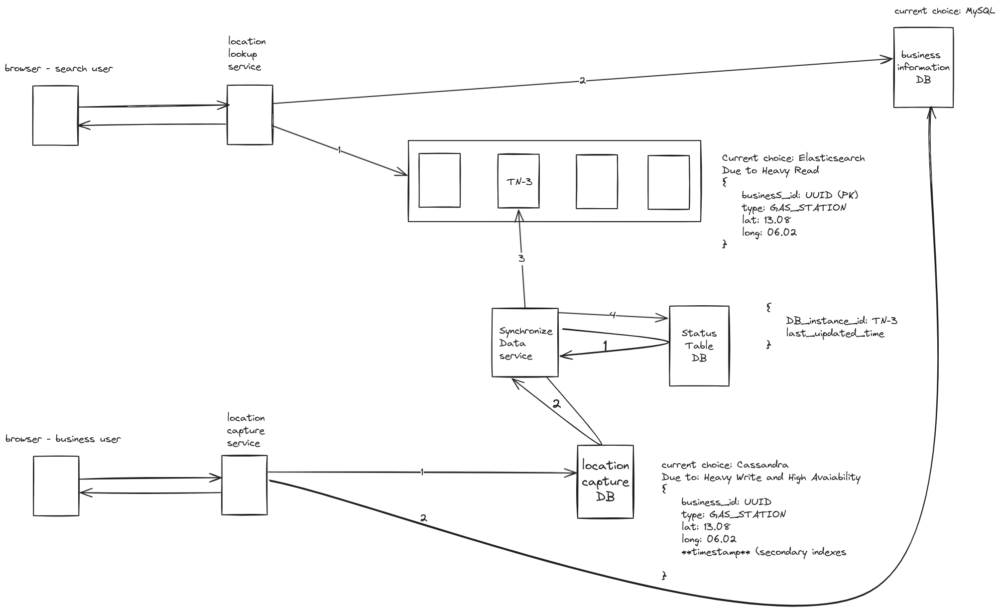

## Table of contents
* [General info](#general-info)
* [Technologies](#technologies)
* [System Design](#system-design)
* [Set up](#set-up)
* [API Endpoint](#api-endpoint)
* [Testing Solution](#testing-solution)

## General info
**Proximity System**

A system aims to help user to find the nearest business shop they need

## Technologies
* Java 17
* Springboot 3.1.10
* Elasticsearch
* MySql
* Cassandra
* TestContainer
* Maven

## System Design

## Set up
* You can use docker to set up the database ( this is not requirement, just an optional)
* Use docker-compose.yml file attached to this folder to init the setup

## API Endpoint

## Testing Solution
* Unit Test - JUnit 5
* Integration Test - JUnit 5 and TestContainers
* Load Test - JMeter

