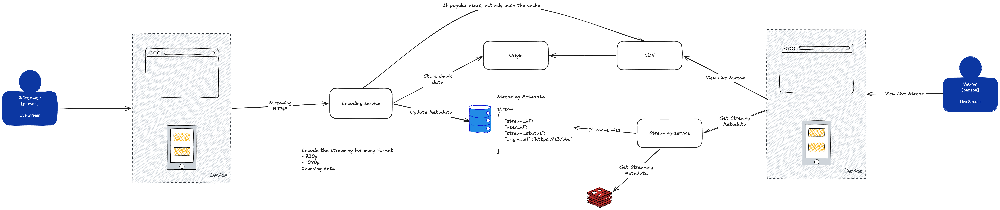

## Table of contents
* [General info](#general-info)
* [Technologies](#technologies)
* [System Design](#system-design)
* [Set up](#set-up)
* [End-to-end flow](#end-to-end-flow)
* [API Endpoint](#api-endpoint)
* [Project Layout](#project-layout)
* [Testing Solution](#testing-solution)
* [Notes / Deviations](#notes--deviations)

## General info
**Twitch System**

A system aims to let a streamer push live video and let viewers watch it in the browser, built step by step. Everything runs in Docker as a monorepo of services.

```
OBS ──RTMP──▶ encoding-service ──HLS files──▶ cdn ──HLS──▶ viewer (browser hls.js)
 (streamer)    (Go RTMP + FFmpeg)    (origin)   (nginx cache)   (viewer)
                                               ▲
                                               │ playback URL
                              streaming-service (Go REST API, Postgres)
```

| Service | Role | Port (host) |
|---|---|---|
| `encoding-service` | Go RTMP ingest + FFmpeg transcode to HLS (origin) | 1935 (RTMP), 8080 (HLS) |
| `cdn` | nginx proxy cache to origin, serves viewers | 8081 |
| `postgres` | metadata DB | 5432 |
| `streaming-service` | Go REST API (stream metadata) | 8082 |
| `viewer` | static hls.js page | 8083 |

## Technologies
* Go 1.24
* GORM + PostgreSQL 16
* `yutopp/go-rtmp` + `yutopp/go-flv` (RTMP ingest, FLV muxing)
* FFmpeg (transcode to HLS)
* nginx (proxy cache CDN + static viewer)
* hls.js (browser playback)
* Docker / Docker Compose
* Testify

## System Design


## Set up

```bash
cd twitch-system
docker compose up -d --build
```

First build compiles the Go services (runs `go mod tidy` inside the image to generate `go.sum`). Wait for `streaming-service` to become healthy.

### Local (non-Docker) dev

```bash
cd twitch-system/streaming-service
cp .env.example .env
make run            # needs Postgres running (docker compose up -d postgres from twitch-system/)
```

## End-to-end flow

### 1. Create a stream (metadata)

```bash
curl -X POST http://localhost:8082/api/v1/streams \
  -H "Content-Type: application/json" \
  -d '{"user_id":"u1","title":"my first stream"}'
```

Response contains `id` and `stream_key` (e.g. `abc123...`). The `stream_key` is what OBS uses as the RTMP stream key.

### 2. Start the stream (mark live)

```bash
curl -X POST http://localhost:8082/api/v1/streams/1/start
```

Response now has `"status":"live"` and an `origin_url` (`http://localhost:8081/hls/<stream_key>.m3u8`).

### 3. Push video (OBS)

OBS → Settings → Stream:

| Field | Value |
|---|---|
| Service | Custom... |
| Server | `rtmp://localhost:1935/live` |
| Stream Key | the `stream_key` from step 1 |

Start Streaming.

> No OBS handy? Push a test pattern with FFmpeg:
> ```bash
> ffmpeg -re -f lavfi -i testsrc=size=1280x720:rate=30 \
>   -f lavfi -i sine=frequency=1000 \
>   -c:v libx264 -preset veryfast -b:v 2500k \
>   -c:a aac -b:a 128k -f flv rtmp://localhost:1935/live/<stream_key>
> ```

### 4. Watch (viewer)

Open http://localhost:8083 in a browser, enter the stream id (default 1), click Load. The page asks `streaming-service` for the `origin_url`, then plays it via hls.js from the CDN.

## API Endpoint

|Endpoint|Method|Description|
|---|---|---|
|/api/v1/streams|POST|Create stream (body: `user_id`, `title`)|
|/api/v1/streams/{id}|GET|Get stream metadata|
|/api/v1/streams/{id}/start|POST|Mark live and set playback URL|
|/api/v1/streams/{id}/stop|POST|Mark ended|
|/healthz|GET|Health check|

Status transitions: `offline → live → ended` (only forward; illegal transitions return 409).

## Project Layout

```
twitch-system/
├── docker-compose.yaml              # all services + wiring
├── encoding-service/                # BE 1: Go RTMP ingest + FFmpeg → HLS
│   ├── cmd/  config/  internal/
│   ├── go.mod  Dockerfile  .env.example
├── streaming-service/               # BE 2: Go REST API (view/stream metadata)
│   ├── cmd/  config/  internal/  pkg/
│   ├── go.mod  Dockerfile  Makefile  .env.example
├── cdn/                             # nginx proxy cache config
│   └── nginx.conf
└── viewer/                          # hls.js player page
    └── index.html
```

### Go service (clean architecture)

```
streaming-service/
├── cmd/app/main.go                  # entry point
├── config/config.go                 # env config (caarlos0/env)
├── internal/
│   ├── app/app.go                   # lifecycle + graceful shutdown
│   ├── deps/deps.go                 # DI wiring
│   ├── domain/stream.go             # entity + rules (pure)
│   ├── handler/rest/                # HTTP handlers
│   ├── usecase/                     # orchestration (contracts + stream/)
│   ├── service/                     # business logic (contracts + stream/)
│   └── repo/                        # persistence (contracts + persistent/stream/)
├── pkg/
│   ├── apperror/                    # typed errors → HTTP status
│   ├── httpserver/                  # net/http lifecycle wrapper
│   └── logger/                      # slog-backed logger
└── Dockerfile
```

Layer flow: `handler → usecase → service → repo → domain`. Interfaces live in each layer's `contracts.go`; wiring in `deps.go`.

## Testing Solution
* Unit Test - Go `testing` + Testify

```bash
cd twitch-system/streaming-service
make test-unit
```

* Manual verification of each piece independently:

```bash
# Encoding works (HLS files grow every ~4s)
docker compose exec encoding-service ls /data/hls/

# Origin serves the playlist
curl http://localhost:8080/hls/<stream_key>.m3u8

# CDN serves (note X-Cache-Status: MISS then HIT)
curl -s -o /dev/null -D - http://localhost:8081/hls/<stream_key>.m3u8

# API is healthy
curl http://localhost:8082/healthz
```

## Notes / Deviations
Deviations from a production Twitch system:

* No auth, no chat, no VOD, no viewer count — single-purpose metadata API.
* CDN is a single nginx cache node (real systems use a distributed CDN + edge PoPs, and push the origin to object storage like S3).
* `AutoMigrate` is used for demo convenience; production uses versioned migrations.
* `encoding-service` is a Go RTMP server built on `yutopp/go-rtmp` (RTMP protocol) + `yutopp/go-flv` (FLV muxing). The Go binary *orchestrates* FFmpeg (spawns it, pipes FLV to its stdin) — it does not reimplement the codec; the actual encoding is FFmpeg. This mirrors real systems: ingest/transcode is a media pipeline, not a CRUD API.
